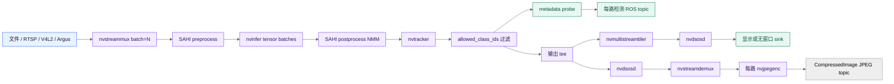

# 三路 SAHI 管线架构

## 目标

这条管线把多路视频或 CSI 相机统一成一个 DeepStream batch，同时保留每路 source 的身份。SAHI 对三路 source 共用一组 `rois`：非空时按显式 `[left, top, width, height]` 列表裁剪，空列表时按 overlap 生成默认网格，并可额外加入全图 ROI；检测结果先合并，再交给 tracker。ROS 2 元数据在 tiler 前读取，避免把不同 source 缩放到合成画布后再反推坐标。

## 数据流



source bin 按 source 类型选择取流器：`argus://N` 进入 `nvarguscamerasrc`，文件和 RTSP 进入 URI source，V4L2 进入显式 raw caps 的本地设备路径。streammux 的 batch 是 source 数；SAHI 的总 ROI 数是 source 数乘以每路 ROI 数。`pgie_batch_size` 可以小于总数，但必须整除总数，默认三路 profile 以 batch 1 分段推理。

## 为什么保留全图 ROI

局部切片能提高小目标的输入分辨率，但切片边界会带来重复框和边缘上下文缺失。全图 ROI 为整帧目标提供一次完整上下文；NMM 再按配置的 IOS 或 IOU 阈值合并重复结果。NMM 放在 tracker 前，使 tracker 只接收已经去重的候选框。

## source 身份和坐标

`sources[i]`、DeepStream `source_id=i`、`source_names[i]`、OSD tile 和 `/deepstream/<source_name>/detections` 是同一条映射链。metadata probe 在 tiler 前执行，因此发布的 bbox 不受 2x2 布局缩放影响。显示端的 OSD 可以使用 source name、类别、置信度和 tracking ID 作为可视化上下文。

## tracker 和检测间隔

`det_interval` 控制 nvinfer 的检测频率。检测不运行的帧仍可能包含 tracker metadata；发布层选择可用的 detector 或 tracker confidence，并继续发布当前帧的数组。`tracker_enabled` 关闭时，检测仍可发布，但未跟踪目标没有稳定的 `Detection2D.id`。

## 显示与 ROS 的分离

显示 sink 是可选末端。`display:=false` 时，管线仍可运行 metadata probe 和 ROS
publisher，不创建可见窗口；native SAHI allocator 仍需要 NVIDIA EGL 资源，无窗口
模式使用 surfaceless EGL，显示模式再增加 X11 资源。`publish_annotated` 从 tracker
后旁路，经过逐路 OSD、`nvstreamdemux` 和 NVIDIA JPEG encoder，最终只在 appsink
边界复制 JPEG 字节，不复制 raw BGR 帧。

## NVIDIA 内存边界

管线的性能和稳定性依赖于明确的内存边界，而不是单纯依赖元素名称：

| 阶段 | 主要数据 | 设计约束 |
| --- | --- | --- |
| 文件解码 | `NVMM` video surface | `nvv4l2decoder` 直接把解码结果交给 DeepStream。 |
| V4L2 输入 | raw `UYVY` -> `NV12/NVMM` | `nvvideoconvert` 在 Jetson profile 中使用 GPU compute；180 度转换不能依赖默认 VIC 路径。 |
| SAHI scaling pool | `NvBufSurface` | 使用 CUDA device memory，避免长期 tensor preparation 依赖 surface-array 拷贝。 |
| Tensor pool | CUDA device pointer | `CustomTensorPreparation` 把 ROI surface 组织成 `nvinfer` 的 tensor meta。 |
| ROS 检测 | `Detection2DArray` | 只复制 metadata 和标量字段，不把 raw 图像转成 CPU BGR。 |
| annotated image | JPEG bytes | 仅在 `nvjpegenc` 后的 appsink 边界复制到 ROS 消息。 |

因此 `video/x-raw(memory:NVMM)` caps 不是装饰信息，它是 source、转换器、mux、tracker 和输出分支之间的资源契约。某个分支需要 CPU 内存时，应把边界放在明确的 appsink 或编码器之后，并用独立 queue 隔离回压。

## 两层 batch 约束

`nvstreammux` 的 batch 和 SAHI 的 tensor batch 解决不同问题。前者按 source 数把帧组织成 `NvDsBatchMeta`；后者按 ROI 数把每个 source 的切片送入 TensorRT。以当前三路 profile 为例：

```text
3 sources
  -> nvstreammux batch-size=3
  -> 4 ROIs/source (3 slices + full frame)
  -> 12 total ROIs
  -> nvinfer tensor batch-size=1
  -> 12 tensor batches
```

节点在建管线前验证 `total_rois % pgie_batch_size == 0`，并为当前 batch 生成独立的 TensorRT engine 配置和 preprocess buffer pool。这样可以把 batch 不匹配从运行时 CUDA/TensorRT 错误提前变成启动时配置错误。

## Native SAHI 的异步生命周期

`nvsahipreprocess` 使用 `NvBufSurfTransform` 生成切片。transform 可能异步完成，所以输入 surface、输出 surface 和 sync object 的生命周期必须跨过 queue handoff：

```text
GStreamer streaming thread
    -> create ROI units and submit NvBufSurfTransform
    -> enqueue NvDsPreProcessBatch
    -> output loop waits for sync object
    -> CustomTensorPreparation
    -> attach tensor metadata
    -> nvinfer consumes metadata
```

插件在 output loop 等待 transform 完成后才释放 sync object，并保持 batch 所需的 backing buffer 有效。这个顺序是正确性约束；提前复用 surface descriptor 可能表现为偶发 `Failed in mem copy`、非法 CUDA 地址或 TensorRT 内部错误，而不是稳定的启动失败。

## Metadata 与输出职责

native postprocess 在 tracker 前修改对象 metadata，执行 ROI 坐标还原和 NMM；tracker 只接收已经合并的候选框。节点把 probe 放在 tracker 后、输出 tee 前，因此同一份 `NvDsBatchMeta` 同时服务于：

- 按 `source_id -> source_names` 发布原图坐标的 ROS detection topic。
- 经过 tiler 和 OSD 的可视化分支。
- 经过 demux、JPEG 编码和 appsink 的逐路 annotated image 分支。

这三个消费者的坐标和 source 身份一致，但它们的资源代价不同。检测 topic 不需要等待显示 sink；显示和 JPEG 分支使用有限、可丢帧的 queue，避免慢消费者阻塞检测主路径。

## 运行时 engine 与原始配置

仓库保留版本控制中的相对路径配置，但节点在启动时复制并解析为运行时配置：ONNX、parser、label 和 native library 使用绝对路径，TensorRT engine 按 batch、GPU 和精度选择缓存位置，preprocess pool 按活动 ROI 数扩展。`.cache/engines` 中的 engine 不是跨 Jetson、TensorRT 或 batch 通用的模型文件；删除或更换这些条件后，应允许节点重新生成匹配的 engine。

## 运行期错误与释放

DeepStream 的 bus thread 负责观察 `ERROR`、`EOS` 和 `STATE_CHANGED`。收到运行期错误时，节点先把 pipeline 置为 `NULL`，再等待非当前 bus thread，清理 bus、appsink 和 source 相关状态，最后关闭 ROS 2 context。`stop_pipeline()` 使用锁并可重复调用，因此错误处理、SIGINT 和节点销毁不会同时释放同一组 GStreamer 对象。

这个顺序对 V4L2 尤其重要：只把 `_running` 设为 `false` 不会释放 `v4l2src` 的设备句柄，下一次 launch 就可能得到 `Device or resource busy`。设备 busy 发生时，先检查上一轮 pipeline 是否真正进入 `NULL` 并确认进程退出，再检查物理设备路径。

## 相关文档

- 边运行边学习上述边界见[理解 NVIDIA DeepStream 管线](../tutorial/understand-nvidia-pipeline.md)。
- 参数和约束见[配置参考](../reference/configuration.md)。
- 消息字段见[ROS 2 话题参考](../reference/ros2-topics.md)。
- 运行时资源见[运行时要求](../reference/runtime-requirements.md)。
- CSI 相机输入的前置检查见[CSI 相机输入验证](../how-to/verify-csi-camera-input.md)。
