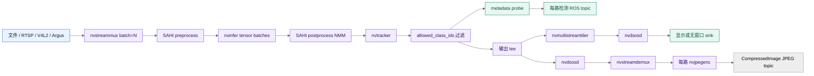

# 三路 SAHI 管线架构

## 目标

这条管线把多路视频或 CSI 相机统一成一个 DeepStream batch，同时保留每路 source 的身份。SAHI 对三路 source 共用一组 `rois`：非空时按显式 `[left, top, width, height]` 列表裁剪，空列表时按 overlap 生成默认网格，并可额外加入全图 ROI；检测结果先合并，再交给 tracker。ROS 2 元数据在 tiler 前读取，避免把不同 source 缩放到合成画布后再反推坐标。

## 数据流

source bin 按 source 类型选择取流器：`argus://N` 进入 `nvarguscamerasrc`，文件和 RTSP 进入 URI source，V4L2 进入显式 raw caps 的本地设备路径。streammux 的 batch 是 source 数；SAHI 的总 ROI 数是 source 数乘以每路 ROI 数。`pgie_batch_size` 可以小于总数，但必须整除总数，默认三路 profile 以 batch 1 分段推理。

## 为什么保留全图 ROI

局部切片能提高小目标的输入分辨率，但切片边界会带来重复框和边缘上下文缺失。全图 ROI 为整帧目标提供一次完整上下文；NMM 再按配置的 IOS 或 IOU 阈值合并重复结果。NMM 放在 tracker 前，使 tracker 只接收已经去重的候选框。

## source 身份和坐标

`sources[i]`、DeepStream `source_id=i`、`source_names[i]`、OSD tile 和 `/deepstream/<source_name>/detections` 是同一条映射链。metadata probe 在 tiler 前执行，因此发布的 bbox 不受 2x2 布局缩放影响。显示端的 OSD 可以使用 source name、类别、置信度和 tracking ID 作为可视化上下文。

## tracker 和检测间隔

`det_interval` 控制 nvinfer 的检测频率。检测不运行的帧仍可能包含 tracker metadata；发布层选择可用的 detector 或 tracker confidence，并继续发布当前帧的数组。`tracker_enabled` 关闭时，检测仍可发布，但未跟踪目标没有稳定的 `Detection2D.id`。

## 显示与 ROS 的分离

显示 sink 是可选末端。`display:=false` 时，管线仍可运行 metadata probe 和 ROS
publisher，不创建可见窗口；native SAHI allocator 仍需要 NVIDIA EGL 资源，无窗口
模式使用 surfaceless EGL，显示模式再增加 X11 资源。`publish_annotated` 从 tracker
后旁路，经过逐路 OSD、`nvstreamdemux` 和 NVIDIA JPEG encoder，最终只在 appsink
边界复制 JPEG 字节，不复制 raw BGR 帧。

## 相关文档

- 参数和约束见[配置参考](../reference/configuration.md)。
- 消息字段见[ROS 2 话题参考](../reference/ros2-topics.md)。
- 运行时资源见[运行时要求](../reference/runtime-requirements.md)。
- CSI 相机输入的前置检查见[CSI 相机输入验证](../how-to/verify-csi-camera-input.md)。
