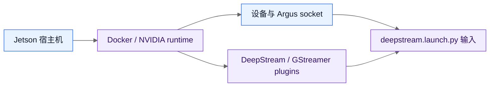

# 运行时要求

本页列出仓库在容器内构建和在 Jetson 上运行时的前置条件。它是参考文档；具体操作见[现有容器安装指南](../how-to/install-in-existing-container.md)，相机输入验证见[CSI 相机输入验证](../how-to/verify-csi-camera-input.md)。

## 目录

- [解说](#解说)
- [参考场景](#参考场景)
  - [文件或 V4L2 输入](#文件或-v4l2-输入)
  - [Argus CSI 输入](#argus-csi-输入)
- [组件与参数说明](#组件与参数说明)
  - [组件说明](#组件说明)
  - [参数说明](#参数说明)

## 解说

运行环境由 Jetson 设备、NVIDIA 容器运行时、DeepStream/GStreamer 插件和 ROS 2 工作区组成。当前三相机 V4L2 输入共享 GPU、EGL、`/dev` 设备节点和 native SAHI plugin；无窗口 V4L2 使用 surfaceless EGL，显示模式才需要 X11。Argus CSI 是独立可选路径，额外需要 camera module 枚举和 `/tmp/argus_socket`。

资源检查只能说明依赖存在，不能单独证明相机已经出帧、TensorRT engine 已构建或 ROS 2 topic 正常发布。相机必须继续执行对应的 GStreamer probe；完整检查顺序见[三路管线验证手册](../how-to/verify-milestones.md)。

## 参考场景

### 文件或 V4L2 输入

```gherkin
Feature: 使用非 Argus 输入启动管线
  Background:
    Given 容器已映射 GPU、设备节点和所需 EGL 资源（显示模式另需 X11）
    And native SAHI plugin 已安装

  Scenario: 使用文件或 V4L2 source
    Given source 使用文件 URI 或实际存在的 V4L2 设备
    When 节点启动 DeepStream 管线
    Then 输入帧进入 NV12/NVMM 和 nvstreammux
    And 不要求 `/tmp/argus_socket`
```

### Argus CSI 输入

```gherkin
Feature: 使用 Argus CSI 输入启动管线
  Background:
    Given 宿主机已注册 camera module 且 nvargus-daemon 正常运行
    And 容器已映射 `/dev`、`/tmp/argus_socket` 和 NVIDIA runtime

  Scenario: 验证三路 CSI source
    Given sensor-id 为 0、1、2 的每一路都能独立输出帧
    When 节点使用 `config/csi_3cam.yaml` 启动
    Then 三个 source 初始化并进入 DeepStream 输入边界
    And 日志不包含 `No cameras available`
```

## 组件与参数说明

### 组件说明



#### 项目目录

安装脚本只在仓库下创建以下目录，不把项目插件写入 `/opt`：

| 路径 | 内容 |
| --- | --- |
| `.venv/` | 使用系统 site-packages 的 Python 虚拟环境。 |
| `.local/lib/gstreamer-1.0/` | SAHI GStreamer 插件。 |
| `.deps/` | 本地构建和 pip 缓存。 |
| `.state/` | 环境快照和验证记录。 |
| `.colcon/` | ROS 2 构建、安装和日志输出。 |

#### 宿主机与容器软件

现有容器必须使用与 JetPack 匹配的 Jetson 软件栈，并提供：

- NVIDIA 驱动和 NVIDIA Container Runtime。
- CUDA runtime、CUDA CRT 开发头文件；文档默认使用 CUDA 12.6。
- `libnvinfer-dev` 和 `libnvonnxparsers-dev` TensorRT 开发头文件。
- DeepStream SDK 头文件和库，默认路径为 `/opt/nvidia/deepstream/deepstream`。
- GStreamer 开发头文件、`gst-launch-1.0`、`gst-inspect-1.0` 和 pkg-config。
- Python 3 开发头文件、`venv` 和 GStreamer Python 绑定。
- ROS 2 Humble、`vision_msgs`。
- 与 Python、Jetson、CUDA 和 DeepStream 版本匹配的 NVIDIA `pyds` 1.2.0 wheel。

CUDA、DeepStream、Python 和 `pyds` 必须相互匹配。仓库脚本不会替换系统 CUDA 或 DeepStream。安装脚本可以安装文档列出的 ROS 2 包，但仍需要正确的 ROS 2 Humble apt 源。

#### 构建输入

native SAHI 插件源码位于仓库的 `plugins/nvsahipreprocess` 和
`plugins/nvsahipostprocess`，构建时只依赖本机 CUDA、GStreamer 和 DeepStream
开发文件。

`scripts/build_sahi_plugins.sh` 只构建以下两个插件：

```text
nvsahipreprocess
nvsahipostprocess
```

输出位于 `.local/lib/gstreamer-1.0`。加载环境后检查：

```bash
source scripts/env.sh
gst-inspect-1.0 nvsahipreprocess nvsahipostprocess
```

#### CSI 运行时

CSI 取流必须同时满足以下条件：

- Jetson 宿主机的相机驱动已经注册预期的 sensor。
- 宿主机 `nvargus-daemon` 正常运行，并且 Argus 能枚举相机。
- 容器使用 NVIDIA runtime，并映射 `/dev` 或所需 NVIDIA 设备节点。
- 容器挂载宿主机 `/tmp/argus_socket` 到同一路径。
- 容器具有足够共享内存、EGL 资源和权限；显示模式另需 X11 资源。
- `nvarguscamerasrc` 插件存在。

启动容器时至少需要包含：

```bash
--runtime nvidia \
--privileged \
--ipc=host \
--network=host \
-v /dev:/dev \
-v /tmp/argus_socket:/tmp/argus_socket \
-v /tmp/.X11-unix:/tmp/.X11-unix:rw
```

`/tmp/argus_socket` 存在只证明 IPC socket 已映射，不证明相机可用。验证顺序应为：

```bash
# 宿主机
v4l2-ctl --list-devices
systemctl is-active nvargus-daemon

# 容器
./scripts/check_runtime.sh --require-argus
gst-inspect-1.0 nvarguscamerasrc
for sensor_id in 0 1 2; do
  ./scripts/probe_argus_camera.sh "$sensor_id" 120
done
```

然后逐个运行 `scripts/probe_argus_camera.sh`，确认每一路真实输出 120 个 buffer 且没有 Argus 错误。`gst-launch-1.0` 可能在 Argus 错误后收到 EOS 并返回 0，退出码不能单独作为通过条件。

仓库的 Argus 配置使用 [`config/csi_3cam.yaml`](../../config/csi_3cam.yaml)。如果宿主机设备树没有 `tegra-camera-platform` 或 Argus camera module 描述，Docker 配置正确也不能让 `nvarguscamerasrc` 发现相机。

#### V4L2 三相机路径

三相机使用 [`config/v4l2_3cam.yaml`](../../config/v4l2_3cam.yaml)，并通过稳定的 `/dev/v4l/by-path` 链接绑定 capture index。当前 profile 的物理顺序为 index0、index6、index8，对应 `camera_0`、`camera_1`、`camera_2`：

```text
/dev/v4l/by-path/...index0 -> camera_0
/dev/v4l/by-path/...index6 -> camera_1
/dev/v4l/by-path/...index8 -> camera_2
```

使用前应按设备报告的实际格式调整：

```text
UYVY 1920x1080@30 -> v4l2src io-mode=2 -> nvvideoconvert -> NV12/NVMM
```

V4L2 路径不需要 `/tmp/argus_socket`，但仍需要 `/dev`、GPU、EGL 和 NVIDIA GStreamer 插件。无窗口 V4L2 使用 surfaceless EGL；显示模式才需要 X11。`v4l2-ctl` 是格式枚举工具，不是容器内 NVMM 取流的必要条件；`scripts/probe_v4l2_camera.sh` 在容器缺少它时会跳过枚举并继续执行 GStreamer 检查。稳定 by-path 缺失时必须失败，不要回退到 `/dev/videoN`。

#### 可写根文件系统与环境检查

所有会写入项目的脚本都要求仓库根目录可写。apt 安装还要求容器根文件系统可写且进程 UID 为 0：

```bash
id -u
test -w .
test -w /
```

`test -w /` 失败表示容器根文件系统以只读方式挂载；root 权限不能改变只读挂载。此时应重建可写容器，或使用已经包含依赖的镜像。只读容器仍可运行 `scripts/capture_environment.sh` 保存环境快照。

运行前检查：

```bash
./scripts/capture_environment.sh
./scripts/check_runtime.sh
./scripts/check_runtime.sh --require-gpu
./scripts/check_runtime.sh --require-display
./scripts/check_runtime.sh --require-argus
```

这些脚本检查资源是否存在，但不能单独证明 Argus sensor、NVMM 帧、TensorRT engine 或显示输出已经工作；相机取流必须继续执行对应的 GStreamer probe。

### 参数说明

运行环境的关键条件可按以下形式记录：

```yaml
runtime:
  platform: jetson
  deepstream: "7.1"
  cuda: "12.6"
  ros: humble
  argus_socket: /tmp/argus_socket
```

| 条件 | 类型 / 默认 | 说明 |
| --- | --- | --- |
| `platform` | string / `jetson` | 必须使用与 DeepStream 和 JetPack 匹配的 Jetson 环境。 |
| `deepstream` | string / `7.1` | DeepStream SDK、插件和运行时库必须保持同一版本。 |
| `cuda` | string / `12.6` | CUDA runtime、开发头文件和 TensorRT 构建环境必须匹配。 |
| `ros` | string / `humble` | 需要 ROS 2 Humble、`vision_msgs` 和可用的 Python 绑定。 |
| `argus_socket` | path / `/tmp/argus_socket` | Argus CSI 必须映射宿主机 socket；V4L2 和文件输入不要求该路径。 |
| `writable_root` | bool / `true` | 安装依赖和构建产物需要可写的仓库与容器根文件系统。 |
