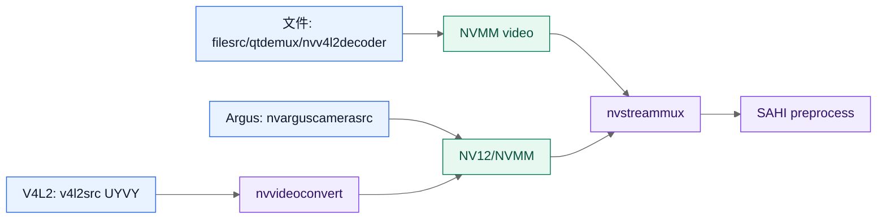
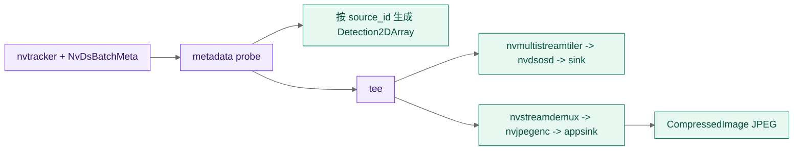

# 从首帧到检测消息：理解 NVIDIA DeepStream 管线

本教程带你运行一次三路 headless SAHI 管线，并沿着一帧数据经过的边界理解仓库中的 NVIDIA 设计。完成后，你应该能回答三个问题：输入帧在哪些阶段保持 GPU 可用内存、三路 source 和 SAHI ROI 如何形成不同的 batch、检测结果为什么能在 tiler 之前发布为原图坐标。

本教程使用文件输入，目的是隔离 DeepStream 和 NVIDIA 资源。换成 V4L2 或 Argus 后，`nvstreammux`、SAHI、TensorRT、tracker 和 ROS 2 元数据边界保持不变；只有 source bin 和相机前置条件不同。

## 学习目标

- 识别 source、`nvstreammux`、native SAHI plugin、`nvinfer`、tracker 和 ROS 2 probe 的职责。
- 区分 streammux batch、SAHI ROI 总数和 `nvinfer` tensor batch。
- 理解 `NVMM`、CUDA device memory、EGL 和 CPU 拷贝各自出现的位置。
- 用 `gst-inspect-1.0`、ROS 2 topic 和运行时日志验证自己的理解。

## 前置条件

- Jetson 上已准备 DeepStream 7.1、CUDA/TensorRT、ROS 2 Humble 和 NVIDIA `pyds`。
- 已按[在现有容器中安装](../how-to/install-in-existing-container.md)完成 native plugin 和 ROS 2 包构建。
- 模型、YOLOv11s parser 和 DeepStream sample video 已存在。
- 当前 shell 位于仓库根目录，并且运行在 NVIDIA runtime 容器内。

先确认环境和构建产物：

```bash
cd /workspace/deepstream-sahi
source scripts/env.sh
source .colcon/install/setup.bash
./scripts/check_runtime.sh --require-gpu
gst-inspect-1.0 nvsahipreprocess nvsahipostprocess
ros2 pkg prefix deepstream
```

预期结果是 GPU 设备、DeepStream 和两个仓库 native plugin 都存在。`nvsahipreprocess` 或 `nvsahipostprocess` 缺失时，先执行 `./scripts/build_sahi_plugins.sh`，不要继续排查 topic。

## 1. 启动一条可观察的管线

使用无窗口 profile 启动三路文件：

```bash
./scripts/run_sim_3cam_headless.sh
```

在另一个终端加载相同的 ROS 2 环境，观察状态和检测 topic：

```bash
source /opt/ros/humble/setup.bash
source /workspace/deepstream-sahi/.colcon/install/setup.bash
ros2 topic echo --once /deepstream/status
ros2 topic list | sort | grep '/deepstream/.*/detections'
ros2 topic hz /deepstream/camera_0/detections
```

应该看到 `initialized`、`running` 状态，以及 `camera_0`、`camera_1`、`camera_2` 三个检测 topic。`ros2 topic hz` 统计的是检测消息，不是 source 的原始相机帧率；`det_interval`、ROI 数量和推理耗时都会影响它。

### 检查点

此时先不要打开 OSD。headless profile 把显示 sink 换成 `fakesink`，仍然保留 metadata probe 和检测发布。这样可以先判断 GPU 推理、SAHI 和 ROS 2 是否工作，再单独判断 X11/EGL 显示资源。

## 2. 沿着 GPU 数据流看 source

仓库为文件、RTSP、V4L2 和 Argus 分别创建 source bin，但它们都在进入 `nvstreammux` 前尽量保持 NVIDIA 内存：



在文件路径中，`nvv4l2decoder` 直接产生 NVMM。V4L2 的原始 `UYVY` 先由 `nvvideoconvert` 转成 `NV12/NVMM`；当前 Jetson profile 为 180 度相机转换显式选择 GPU compute，避免长期运行时落入不稳定的 VIC 拷贝路径。Argus source 本身提供 Jetson camera surface，但仍要求宿主机的 `nvargus-daemon`、容器中的 `/tmp/argus_socket` 和正确的设备树。

查看 profile 中的输入边界：

```bash
sed -n '1,32p' config/sim_3cam_headless.yaml
sed -n '1,20p' config/v4l2_3cam.yaml
```

其中 `UYVY 1920x1080@30` 描述 V4L2 输入能力，`camera_fps` 不等于检测 topic 的承诺频率。V4L2 的稳定设备身份使用 `/dev/v4l/by-path`，不使用会随枚举顺序变化的 `/dev/videoN`。

### 检查点

执行下面的检查可以确认插件存在，但不能证明真实帧已经经过 NVMM：

```bash
gst-inspect-1.0 v4l2src nvvideoconvert nvstreammux
```

真实相机还需要逐路执行 `scripts/probe_v4l2_camera.sh`；Argus 则需要逐个执行 `scripts/probe_argus_camera.sh`。设备、EGL 和推理验证是三个不同边界，不能用一个成功替代另一个。

## 3. 分清三个 batch

这个 profile 同时存在三个容易混淆的数量：

| 数量 | 当前值 | 由谁决定 | 作用 |
| --- | ---: | --- | --- |
| streammux batch | 3 | source 数量 | 一次把三路 source 组织进一个 `NvDsBatchMeta`。 |
| 每路 ROI | 4 | 三个显式切片加一个全图 ROI | 为每个 source 生成小目标检测输入。 |
| SAHI 总 ROI | 12 | source 数乘以每路 ROI | 需要由 `nvinfer` 消费的 tensor 单元总数。 |

`pgie_batch_size: 1` 是 tensor batch，不是 streammux batch。它表示 `nvinfer` 一次消费一个 640x640 tensor；12 个 ROI 会被拆成 12 个 tensor batch。节点在启动前检查 `source_count * roi_count` 能被 `pgie_batch_size` 整除，并据此生成运行时 TensorRT 和 preprocess 配置。

用配置和启动日志核对这组关系：

```bash
grep -E 'sources:|rois:|include_full_frame|pgie_batch_size|det_interval' \
  config/sim_3cam_headless.yaml
grep -E 'batch-size|network-input-shape|scaling-buf-pool-size|tensor-buf-pool-size' \
  config/config_infer_primary_yolov11s_sahi.txt \
  config/config_preprocess_yolov11s_sahi.txt
```

可以把 `pgie_batch_size` 临时改成 `2` 重新启动；12 能被 2 整除，节点会为 batch 2 准备独立的运行时配置。改成 `5` 时，启动校验应在建管线前拒绝，因为 12 不能被 5 整除。这种失败比让 TensorRT 在运行中遇到 batch mismatch 更容易定位。

### 为什么默认使用显式 ROI

1920x1080 的自动 640x640 网格会产生更多 ROI；当前 profile 用三个横向切片加全图 ROI，把推理量和小目标覆盖范围固定下来。全图 ROI 保留完整上下文，切片 ROI 提高小目标的有效输入分辨率；后续 NMM 用 `ios` 阈值合并同一目标的重复框。

## 4. 看懂 native SAHI plugin 的边界

管线的核心段是：

```text
nvstreammux
    -> nvsahipreprocess
    -> nvinfer (input-tensor-meta=true)
    -> nvsahipostprocess (NMM)
    -> nvtracker
```

`nvsahipreprocess` 不是普通的 CPU 图像裁剪器。它从 `NvBufSurface` 读取 mux batch，使用 `NvBufSurfTransform` 为每个 ROI 分配/填充 scaling surface，再调用仓库配置的 `CustomTensorPreparation` 生成 nvinfer 需要的 tensor meta。`input-tensor-meta=true` 让 `nvinfer` 消费这份预处理结果，而不是再次按原始帧做一遍输入转换。

预处理包含一个异步边界：transform 完成后才能复用 surface descriptor 和 backing buffer。插件会把 batch 放入内部队列，由 output loop 等待 transform sync object，再调用 tensor preparation，最后把 metadata 交给下游。`scaling-pool-memory-type=2` 选择 CUDA device memory，`scaling-pool-compute-hw=1` 选择 CUDA compute；这两个设置必须和 Jetson 的输入路径一起验证，不能只凭属性名称推断可用。

`nvsahipostprocess` 只修改 DeepStream metadata，不把检测框重新画到 CPU 图像上。它读取每个 ROI 的 detector objects，按 source/frame 还原坐标，在 tracker 前执行两阶段 NMM，并把合并后的对象交给 `nvtracker`。因此 tracker 不会为同一目标的多个重叠切片各创建一个轨迹。

检查 native plugin 暴露的属性和 pad caps：

```bash
gst-inspect-1.0 nvsahipreprocess | sed -n '1,180p'
gst-inspect-1.0 nvsahipostprocess | sed -n '1,160p'
```

重点观察 preprocessor 是否提供 `config-file`、ROI 和 tensor 相关属性，postprocessor 是否提供 merge metric、threshold 和 GIE ID。实际运行时还应在日志中看到 `Using native nvsahipostprocess for NMM (C++ plugin)`。

## 5. 在 metadata 边界发布 ROS 2

仓库把 metadata probe 放在 tracker 后、输出 tee 前：



probe 用 `frame_meta.source_id` 索引 `source_names`，所以 `camera_0` 的名字、检测 topic 和显示 tile 来源于同一条映射。它在 tiler 之前读取 bbox，发布的是原始 source 坐标；tiler 只改变显示画布，不会改变 ROS 检测坐标。允许类别过滤也在这个边界之前完成，使被过滤的对象不会进入 NMM、tracker、OSD 或 ROS 消息。

ROS 2 检测消息在 probe 中直接由 metadata 构造。只有发布 annotated image 时，数据才经过逐路 OSD、`nvstreamdemux`、`nvjpegenc` 和 appsink，并在 appsink 边界复制 JPEG 字节进入 `CompressedImage`。这避免了为了发布 bbox 而把每帧 raw NVMM 图像复制成 CPU BGR。

检查一条消息的 source 和坐标：

```bash
ros2 topic echo --once /deepstream/camera_0/detections
ros2 topic info /deepstream/camera_0/detections
```

即使当前帧没有目标，也应该收到 `detections: []`。这说明消息发布由帧 metadata 驱动，而不是由“是否检测到对象”驱动。

## 6. 把显示分支当成可选消费者

`tee` 后的显示分支包含 tiler、OSD 和 sink。仓库为显示 queue 配置了有限长度和丢帧策略，避免 X11、EGL 或 sink 卡住时反向阻塞检测和 ROS topic。`display:=false` 只关闭可见显示，不关闭 metadata probe、tracker 或检测发布。

先保持 headless。需要区分“OSD 构建正确”和“可见 sink 正常”时，可以使用不显示窗口的 sink：

```bash
EGL_PLATFORM=surfaceless ros2 launch deepstream deepstream.launch.py \
  params_file:=config/sim_3cam_headless.yaml \
  display:=true display_sink:=fakesink publish_detections:=true
```

如果这个命令稳定而 `nv3dsink` 不稳定，问题在显示资源或 sink，而不在 source、SAHI 或 ROS 2。真正的窗口模式还需要 `EGL_PLATFORM=x11`、有效 `DISPLAY`、X11 socket 和授权。V4L2 的 30 分钟检测验收固定使用 headless/surfaceless，显示验收应单独记录。

## 7. 理解 TensorRT engine 为什么按 batch 缓存

启动节点时不会直接使用配置文件中的相对路径。节点会：

1. 把 ONNX、label、parser 和 custom library 路径解析为绝对路径。
2. 把 `pgie_batch_size` 写入运行时 infer 配置。
3. 按 batch、GPU 和精度选择或生成 engine，例如 `yolo11s.onnx_b1_gpu0_fp16.engine`。
4. 按活动 ROI 总数扩展 preprocess pool，确保一整个 mux batch 的 tensor 不会在 nvinfer 消费前被回收。

查看缓存和运行时配置：

```bash
find .cache/engines -maxdepth 1 -type f -printf '%f\n' | sort
find .cache/engines -maxdepth 1 \( -name '*infer*.txt' -o -name 'config_preprocess*.txt' \)
```

首次使用新的 batch 或新的 GPU/精度组合时，engine 生成时间可能较长。engine 与 ONNX、TensorRT、GPU 和 batch 绑定；不要把一台 Jetson 生成的 engine 当作任意设备通用的静态资源。

## 8. 用现象定位错误边界

遇到错误时，先判断它属于哪一段：

| 现象 | 优先检查 | 不要先做的事 |
| --- | --- | --- |
| `No cameras available`、Argus 错误 | 宿主机 camera module、`nvargus-daemon`、`/tmp/argus_socket` | 不要用 V4L2 成功证明 Argus 已通过。 |
| source caps 或 `Device or resource busy` | 稳定 by-path、残留进程、source bin 清理 | 不要回退到 `/dev/videoN`。 |
| `Failed in mem copy`、CUDA illegal address | scaling pool memory、compute hw、异步 surface 生命周期 | 不要只增大 topic 队列或重启 topic。 |
| 检测 topic 没有消息 | `publish_detections`、`vision_msgs`、metadata probe、pipeline state | 不要先判断模型“没有目标”。 |
| topic 正常但窗口卡顿 | X11/EGL、sink、display queue | 不要关闭 headless 检查来掩盖检测问题。 |
| batch mismatch 或 engine 错误 | source 数、ROI 数、`pgie_batch_size`、runtime engine | 不要手工复用不同 batch 的 engine。 |

完整的硬件和长时间验收步骤见[三路管线验证手册](../how-to/verify-milestones.md)，现象到命令的对应关系见[故障排查](../how-to/troubleshooting.md)。

## 下一步

- 逐项查询参数和默认值，阅读[配置参考](../reference/configuration.md)。
- 研究 source、metadata 和输出分支，阅读[三路 SAHI 管线架构](../explanation/architecture.md)。
- 把文件输入换成真实相机，阅读[从文件切换到 CSI](../how-to/switch-file-to-csi.md)或[V4L2 稳定性验收](../how-to/verify-milestones.md)。
- 需要 ROS 2 字段和坐标约定时，阅读[ROS 2 话题参考](../reference/ros2-topics.md)。
